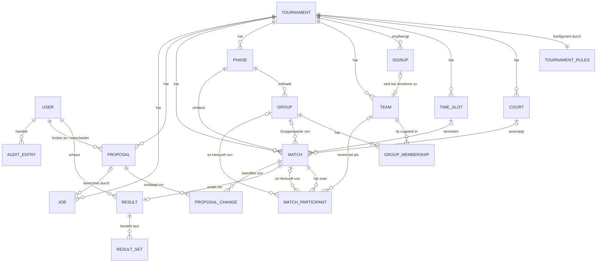

# Entity Model

Dieses Dokument beschreibt die Datensicht von Tournetty. Quelle sind ausschliesslich die
Dokumente unter `docs/` und `PROJECT_CONTEXT.md`: [`SPEC.md`](SPEC.md) §1–§9,
[`requirements.md`](requirements.md) (FR-001–FR-026, NFR-001–NFR-021, C-001–C-016),
[`use-cases/uc-001-turnier-verwalten.md`](use-cases/uc-001-turnier-verwalten.md) (BR-001–BR-009),
[`use-cases/use-case-diagram.md`](use-cases/use-case-diagram.md) (UC-001–UC-028) und
[`api/openapi.yaml`](api/openapi.yaml) (Feldnamen und Typen des Turniers).

**Aufbau:**

* **[Teil A](#teil-a--fachmodell)** — das Fachmodell: Entitäten, Attribute, Beziehungen und die
  Invarianten, die sie zusammenhalten. Technologieneutral.
* **[Teil B](#teil-b--logisches-schema)** — das logische Schema für PostgreSQL (C-004) in
  `snake_case` (§4.2), abgeleitet aus Teil A. Constraints statt Prosa, wo eine Regel sich in der
  Datenbank festschreiben lässt.

**Abgrenzung:** Das Dokument legt fest, *welche Daten* es gibt und *welche Zusagen* über sie
gelten — nicht, mit welchem Werkzeug sie gespeichert werden. Die Wahl zwischen JPA/Hibernate und
JDBC sowie das Migrationswerkzeug sind offen (`PROJECT_CONTEXT.md` §9). Das Schema in Teil B ist
deshalb als DDL formuliert und nicht als Entity-Klassen.

**Version:** 0.1 · **Stand:** 04.11.2026 · **Status:** Entwurf

---

## Die Modellentscheide, auf die sich alles Folgende beruft

Jeder Entscheid nennt das Qualitätsziel oder die Anforderung, aus der er folgt — und was er
kostet.

| ID     | Entscheid                                                                                                    | Getragen von             | Preis                                                                                            |
|--------|--------------------------------------------------------------------------------------------------------------|--------------------------|--------------------------------------------------------------------------------------------------|
| EM-1   | **Zeitfenster ist eine Entität** (`TimeSlot`), nicht ein Zeitstempel an der Partie                            | NFR-001, NFR-003, BR-006 | Spiele lassen sich nur im Raster verschieben; eine Partie «um 14:07» ist nicht modellierbar       |
| EM-2   | **Teilnahme ist eine Entität** (`MatchParticipant`) mit Herkunft, nicht zwei Spalten an der Partie            | NFR-001, FR-016          | Eine Partie zu lesen heisst zwei Zeilen zu lesen; «genau zwei Teilnehmer» ist Regel, kein Schema  |
| EM-3   | **Anmeldung und Team sind getrennt** (`Signup` / `Team`)                                                      | NFR-015, NFR-017         | Der Teamname existiert zweimal — einmal als Fremddatum, einmal als Fachdatum                     |
| EM-4   | **Ergebnisse werden satzweise erfasst** (`Result` / `ResultSet`)                                              | FR-024, NFR-002          | Auch ein Einsatz-Plauschturnier braucht die Satz-Zeile                                           |
| EM-5   | **Tabellenstände werden nicht gespeichert**, sondern berechnet                                                | NFR-002, NFR-005         | Jede Dashboard-Anfrage rechnet; bei grossen Turnieren ist ein Cache nachzurüsten                 |
| EM-6   | **Vorschläge liegen neben dem Spielplan**, nicht darin (`Proposal` / `ProposalChange`)                        | NFR-013, ADR-5           | Der Spielplan muss zweimal gelesen werden, um «Ist-Stand» und «Vorschlag» zu zeigen              |
| EM-7   | **Gruppen hängen an der Phase**, nicht am Turnier                                                             | FR-009, FR-010, FR-016   | Ein Hop mehr von der Gruppe zum Turnier                                                          |
| EM-8   | **Regeln: benannte Spalten für Zahlen, JSONB für die Tie-Breaker-Kette**                                      | NFR-004, ADR-6           | Die Reihenfolge der Tie-Breaker prüft die Datenbank nicht — das muss `scoring/` beim Laden tun    |
| EM-9   | **`BIGSERIAL` für alle IDs**, keine UUIDs                                                                     | BR-001, `openapi.yaml`   | IDs sind aufzählbar; der öffentliche Anmelde-Endpunkt gibt deshalb keine ID zurück               |
| EM-10  | **Optimistisches Sperren über `version`** auf allen bearbeitbaren Entitäten                                    | UC-001 A8, NFR-020       | Jede schreibende Operation braucht die gelesene Version — auch die unstrittige                   |

---

# Teil A — Fachmodell

## A.1 Überblick



Die Lesesichten — Gruppentabelle, K.-o.-Baum, Feldauslastung — sind im Diagramm **nicht**
enthalten. Sie sind abgeleitet (EM-5) und in [A.6](#a6-abgeleitete-sichten) als
Berechnungsvorschrift beschrieben.

## A.2 Entitäten

### Tournament — der Anlass

Ein Turnier ist der eigenständige, referenzierbare Anlass (FR-001, FR-005, UC-001). Alles
Fachliche hängt daran; ein Turnier zu löschen heisst, seine Welt zu löschen (A3).

| Attribut   | Typ                                                 | Pflicht | Regel                                                                                 |
|------------|-----------------------------------------------------|---------|---------------------------------------------------------------------------------------|
| `id`       | Ganzzahl                                            | ja      | systemweit eindeutig, unveränderlich, nach Löschung nicht wiederverwendet (BR-001)     |
| `version`  | Ganzzahl ≥ 1                                        | ja      | bei jeder Änderung erhöht; Grundlage für `409 VERSION_CONFLICT` (A8)                   |
| `name`     | Text, 1–120                                         | ja      | mit dem Kalenderjahr von `date` eindeutig, ohne Rücksicht auf Gross-/Kleinschreibung und umschliessende Leerzeichen (BR-002) |
| `date`     | Datum                                               | ja      | gültiges Kalenderdatum; Vergangenheit erlaubt (BR-005)                                 |
| `location` | Text, 1–120                                         | ja      | Freitext                                                                               |
| `status`   | `PLANNING` \| `RUNNING` \| `FINISHED` \| `ARCHIVED` | ja      | `PLANNING` beim Anlegen; UC-001 erlaubt als Wechsel nur `ARCHIVED` (BR-007, BR-008)    |

**Lebenszyklus.** `PLANNING` → `RUNNING` → `FINISHED`, aus jedem davon nach `ARCHIVED`.
Wer die ersten beiden Übergänge auslöst, ist offen (`PROJECT_CONTEXT.md` §9); das Modell lässt
beide Varianten zu, weil der Status ein Feld und keine berechnete Grösse ist. `ARCHIVED` ist
terminal: ein archiviertes Turnier ist lesbar, aber nicht bearbeitbar (BR-007).

### TournamentRules — die Konfiguration

Ein Turnier hat genau einen Regelsatz (ADR-6, FR-024, NFR-004, UC-005). Die Regeln stehen hier,
damit `scoring/` und `schedule/rules/` sie laden statt sie zu kennen.

| Attribut             | Typ                              | Pflicht | Regel                                                                                      |
|----------------------|----------------------------------|---------|--------------------------------------------------------------------------------------------|
| `tournament_id`      | Ganzzahl                         | ja      | Primärschlüssel — eins zu eins mit dem Turnier                                              |
| `version`            | Ganzzahl ≥ 1                     | ja      | optimistisches Sperren                                                                      |
| `points_win`         | Ganzzahl ≥ 0                     | ja      | Standard 3                                                                                  |
| `points_draw`        | Ganzzahl ≥ 0                     | ja      | Standard 1; bei Modi ohne Remis auf 0 und unbenutzt                                         |
| `points_loss`        | Ganzzahl ≥ 0                     | ja      | Standard 0                                                                                  |
| `sets_to_win`        | Ganzzahl ≥ 1                     | ja      | Gewinnsätze je Partie; 1 für den Plauschfall                                                |
| `points_per_set`     | Ganzzahl ≥ 1                     | ja      | Zielpunktzahl eines Satzes, Obergrenze für die Ergebnisprüfung                              |
| `slot_minutes`       | Ganzzahl ≥ 1                     | ja      | Länge eines Zeitfensters; Vorgabe beim Erzeugen der `TimeSlot`-Folge                        |
| `min_break_slots`    | Ganzzahl ≥ 0                     | ja      | Pausenregel: so viele Zeitfenster liegen mindestens zwischen zwei Partien desselben Teams   |
| `withdrawal_handling`| `ANNUL` \| `FORFEIT`             | ja      | Umgang mit gespielten Partien eines abgemeldeten Teams (UC-002, `PROJECT_CONTEXT.md` v0.6)  |
| `tie_breakers`       | geordnete Liste von Tie-Breakern | ja      | aus `SET_RATIO`, `POINT_DIFF`, `POINTS_SCORED`, `HEAD_TO_HEAD`, `WINS`; mindestens ein Eintrag, keine Dopplung |

**Warum `tie_breakers` eine Liste ist.** Die Kette ist geordnet und beliebig lang — als Spalten
`tie_breaker_1..n` modelliert, bräuchte jeder neue Tie-Breaker eine Migration, und genau das
schliesst NFR-004 aus. Preis: die Datenbank prüft die Liste nicht; `scoring/` validiert sie beim
Laden gegen die zulässigen Werte und lehnt Unbekanntes mit `400 VALIDATION_FAILED` ab (EM-8).

### Court — das Spielfeld

| Attribut        | Typ          | Pflicht | Regel                                                                          |
|-----------------|--------------|---------|--------------------------------------------------------------------------------|
| `id`            | Ganzzahl     | ja      | eindeutig (FR-005)                                                              |
| `tournament_id` | Ganzzahl     | ja      | gehört zu genau einem Turnier                                                    |
| `name`          | Text, 1–60   | ja      | je Turnier eindeutig (FR-004, FR-005)                                            |
| `sequence`      | Ganzzahl ≥ 1 | ja      | Anzeigereihenfolge; je Turnier eindeutig, damit die Verteilung deterministisch ist (NFR-005) |
| `available`     | Wahrheitswert| ja      | `false` heisst: ab jetzt nicht mehr ansetzbar. Bestehende Zuteilungen bleiben, bis umgeplant wird — der Testkorpus-Fall «Feld fällt weg» (NFR-021) |

### TimeSlot — das Zeitfenster

Das diskrete Raster, in dem gespielt wird (EM-1). Es ist der Anker der wichtigsten Invariante
des Systems.

| Attribut           | Typ          | Pflicht | Regel                                                                       |
|--------------------|--------------|---------|-----------------------------------------------------------------------------|
| `id`               | Ganzzahl     | ja      | eindeutig                                                                    |
| `tournament_id`    | Ganzzahl     | ja      | gehört zu genau einem Turnier                                                |
| `sequence`         | Ganzzahl ≥ 1 | ja      | fortlaufend ab 1, je Turnier eindeutig — die fachliche Nummer des Zeitfensters |
| `starts_at`        | Zeitpunkt    | ja      | Beginn; liegt am Turnierdatum                                                |
| `duration_minutes` | Ganzzahl ≥ 1 | ja      | Standard aus `slot_minutes`, je Zeitfenster überschreibbar                   |

**Warum das trägt.** Drei Anforderungen werden damit zu Mengenoperationen statt zu
Intervallrechnung:

* **NFR-001** «ein Team, ein Slot» ist eine Eindeutigkeit über (Zeitfenster, Team) — prüfbar an
  einer Stelle und von der Datenbank erzwingbar ([A.5](#a5-invarianten)).
* **NFR-003** Feldauslastung ist «belegte Felder je Zeitfenster geteilt durch verfügbare Felder»
  — ohne Überlappungslogik.
* **BR-006** Die Datumsänderung verschiebt die Zeitfenster als Ganzes. Sie berührt genau
  `TimeSlot.starts_at`; Paarungen und Feldzuteilung bleiben per Konstruktion unverändert.

Preis: eine Partie kann nur im Raster liegen. Das Verschieben per Drag-and-Drop (FR-013, UC-008)
bewegt sie von Zeitfenster zu Zeitfenster, nicht auf eine beliebige Uhrzeit.

### Signup — die Anmeldung als Fremddatum

Der einzige unauthentifizierte Schreibfall des Systems (UC-009, UC-020, NFR-015, NFR-016). Hier
und nur hier liegen Kontaktdaten.

| Attribut           | Typ                                         | Pflicht | Regel                                                                             |
|--------------------|---------------------------------------------|---------|-----------------------------------------------------------------------------------|
| `id`               | Ganzzahl                                    | ja      | eindeutig; wird dem Absender **nicht** zurückgegeben (EM-9)                         |
| `tournament_id`    | Ganzzahl                                    | ja      | Anmeldung gilt für ein bestimmtes Turnier                                          |
| `status`           | `PENDING` \| `ACCEPTED` \| `REJECTED`       | ja      | entsteht ausschliesslich als `PENDING` (§6)                                        |
| `team_name`        | Text, 1–80                                  | ja      | normalisiert: Leerzeichen getrimmt, Mehrfachleerzeichen zusammengezogen (NFR-015). Je Turnier eindeutig gegen `PENDING`- und `ACCEPTED`-Anmeldungen sowie gegen bestehende Teams (FR-007) |
| `contact_name`     | Text, 1–120                                 | ja      | Teamverantwortliche:r                                                              |
| `contact_email`    | Text, 1–254                                 | ja      | syntaktisch geprüft; kleingeschrieben gespeichert                                  |
| `contact_phone`    | Text, 0–40                                  | nein    | optional, auf Ziffern und `+ /` beschränkt                                         |
| `note`             | Text, 0–500                                 | nein    | Freitextbemerkung des Teams                                                        |
| `submitted_at`     | Zeitpunkt                                   | ja      | Eingang; serverseitig gesetzt, nie aus der Anfrage übernommen                      |
| `source_ip_hash`   | Text, 64                                    | ja      | Hash der Absender-IP. Grundlage des Rate-Limits (NFR-016); die IP selbst wird nicht gespeichert |
| `decided_by`       | Ganzzahl → `User`                           | nein    | gesetzt, sobald angenommen oder abgelehnt (UC-010)                                 |
| `decided_at`       | Zeitpunkt                                   | nein    | wie `decided_by`                                                                   |
| `rejection_reason` | Text, 0–500                                 | nein    | nur bei `REJECTED`                                                                 |

**Warum getrennt vom Team (EM-3).** Drei Gründe, alle aus den Leitplanken:

1. **Vertrauensgrenze.** `Signup` ist das einzige Objekt, das aus ungeprüfter Quelle entsteht.
   Es getrennt zu halten macht die Grenze im Modell sichtbar — und beantwortet die Rückfrage aus
   SPEC Teil C: wer den Endpunkt mit `curl` aufruft, erzeugt eine `PENDING`-Anmeldung und sonst
   nichts.
2. **Pseudonymisierung.** NFR-017 verlangt, dass im KI-Kontext keine Klarnamen und Kontaktdaten
   vorkommen. Da Kontaktdaten ausschliesslich an `Signup` hängen und der Planungskontext aus
   `Team`, `Match` und `TimeSlot` gebaut wird, ist die Anforderung strukturell erfüllt und nicht
   nur durch eine Filterregel.
3. **Nachweis.** Eine abgelehnte Anmeldung bleibt dokumentiert, ohne dass ein Team entsteht.

**Rate-Limit ohne Zähltabelle.** NFR-016 («höchstens 5 Anmeldungen pro IP und Stunde») ist aus
`(source_ip_hash, submitted_at)` abzählbar. Das Modell braucht dafür keine eigene Entität, nur
einen Index ([B.3](#b3-indizes)).

### Team — der Teilnehmer

| Attribut        | Typ                        | Pflicht | Regel                                                                                   |
|-----------------|----------------------------|---------|-----------------------------------------------------------------------------------------|
| `id`            | Ganzzahl                   | ja      | eindeutig (FR-005)                                                                       |
| `tournament_id` | Ganzzahl                   | ja      | gehört zu genau einem Turnier                                                             |
| `version`       | Ganzzahl ≥ 1               | ja      | optimistisches Sperren                                                                   |
| `name`          | Text, 1–80                 | ja      | je Turnier eindeutig, Vergleich ohne Gross-/Kleinschreibung und umschliessende Leerzeichen (FR-002, FR-007) |
| `signup_id`     | Ganzzahl → `Signup`        | nein    | gesetzt, wenn das Team aus einer Anmeldung entstand (UC-010); `NULL` bei direkter Erfassung durch den Organisator (FR-002) |
| `pseudonym`     | Text, 2–8                  | ja      | `T1`…`Tn`, je Turnier eindeutig und stabil. Der einzige Bezeichner, der den `PlanAdvisorPort` passiert (NFR-017) |
| `status`        | `ACTIVE` \| `WITHDRAWN`    | ja      | `WITHDRAWN` ist die Abmeldung (UC-002); das Team wird nicht gelöscht, damit gespielte Partien auflösbar bleiben |
| `withdrawn_at`  | Zeitpunkt                  | nein    | gesetzt mit `WITHDRAWN`                                                                  |

**Warum `pseudonym` gespeichert und nicht berechnet wird.** Ein zur Laufzeit erzeugtes Pseudonym
hinge an der Iterationsreihenfolge und würde NFR-005 (Determinismus) brechen: dieselbe Eingabe
ergäbe je nach Sortierung einen anderen Anfragetext. Gespeichert ist es stabil — und der Test zu
NFR-017 kann prüfen, dass im Anfragetext ausschliesslich Pseudonyme vorkommen.

**Warum `WITHDRAWN` statt Löschen.** Ein abgemeldetes Team hat eventuell schon gespielt. Nach
`withdrawal_handling` werden diese Partien entweder annulliert oder als Forfait gewertet
(UC-002) — beides setzt voraus, dass das Team als Referenz existiert. NFR-002
(Nachrechenbarkeit) verlangt es ebenfalls.

### Phase — die Etappe des Turniers

| Attribut        | Typ                               | Pflicht | Regel                                                                  |
|-----------------|-----------------------------------|---------|------------------------------------------------------------------------|
| `id`            | Ganzzahl                          | ja      | eindeutig (FR-005)                                                      |
| `tournament_id` | Ganzzahl                          | ja      | gehört zu genau einem Turnier                                           |
| `sequence`      | Ganzzahl ≥ 1                      | ja      | Position in der Phasenfolge, je Turnier eindeutig (FR-009, FR-010)      |
| `kind`          | `GROUP_STAGE` \| `KNOCKOUT`       | ja      | Schweizer System ist ausgeschlossen (C-010) — die Aufzählung hat genau zwei Werte |
| `name`          | Text, 1–60                        | ja      | z. B. «Gruppenphase», «Halbfinal»                                       |

**Drag-and-Drop (FR-010)** ändert `sequence`. Weil die Eindeutigkeit über
(`tournament_id`, `sequence`) gilt, wird eine Umordnung als eine Transaktion geschrieben
([B.4](#b4-was-das-schema-nicht-erzwingt)).

### Group — die Gruppe innerhalb einer Phase

| Attribut           | Typ          | Pflicht | Regel                                                                         |
|--------------------|--------------|---------|-------------------------------------------------------------------------------|
| `id`               | Ganzzahl     | ja      | eindeutig (FR-005)                                                             |
| `phase_id`         | Ganzzahl     | ja      | gehört zu genau einer Phase; nur Phasen mit `kind = GROUP_STAGE` haben Gruppen  |
| `name`             | Text, 1–40   | ja      | je Phase eindeutig, z. B. «Gruppe A» (FR-003, FR-005)                           |
| `sequence`         | Ganzzahl ≥ 1 | ja      | Anzeigereihenfolge, je Phase eindeutig                                          |
| `qualifying_ranks` | Ganzzahl ≥ 0 | ja      | wie viele Ränge in die nächste Phase aufsteigen — die Gegenstelle zur Herkunft `GROUP_RANK` (FR-016) |

**Warum an der Phase und nicht am Turnier (EM-7).** Eine Vorrunde und eine Zwischenrunde sind
beide Gruppenphasen mit je eigener «Gruppe A». Hängt die Gruppe am Turnier, kollidieren die
Namen, und die Weiterleitung «Rang 1–2 der Gruppe A» ist nicht eindeutig auflösbar. Zudem gilt
«ein Team in höchstens einer Gruppe» korrekt **je Phase**, nicht je Turnier.

### GroupMembership — die Zuteilung Team ↔ Gruppe

| Attribut   | Typ          | Pflicht | Regel                                                               |
|------------|--------------|---------|---------------------------------------------------------------------|
| `group_id` | Ganzzahl     | ja      | zusammen mit `team_id` Primärschlüssel                               |
| `team_id`  | Ganzzahl     | ja      | das Team gehört zum selben Turnier wie die Gruppe                    |
| `phase_id` | Ganzzahl     | ja      | Phase der Gruppe, mitgeführt für die Eindeutigkeit ([A.5](#a5-invarianten), INV-6) |
| `seed`     | Ganzzahl ≥ 1 | ja      | Position in der Gruppe, je Gruppe eindeutig — macht Round-Robin deterministisch (NFR-005) |

### Match — die Partie

| Attribut        | Typ                                                     | Pflicht | Regel                                                                               |
|-----------------|---------------------------------------------------------|---------|-------------------------------------------------------------------------------------|
| `id`            | Ganzzahl                                                | ja      | eindeutig (FR-005)                                                                   |
| `tournament_id` | Ganzzahl                                                | ja      | redundant zum Weg über die Phase, mitgeführt für Filter und Lesesichten (FR-025)     |
| `phase_id`      | Ganzzahl                                                | ja      | jede Partie gehört zu genau einer Phase                                              |
| `group_id`      | Ganzzahl                                                | nein    | gesetzt bei Gruppenpartien, `NULL` in der K.-o.-Phase                                 |
| `round_number`  | Ganzzahl ≥ 1                                            | ja      | Runde innerhalb der Phase: Round-Robin-Runde bzw. K.-o.-Runde                          |
| `sequence`      | Ganzzahl ≥ 1                                            | ja      | Position innerhalb der Runde; je (Phase, Runde) eindeutig — fixiert die Erzeugungsreihenfolge (NFR-005) |
| `slot_id`       | Ganzzahl → `TimeSlot`                                   | nein    | `NULL` heisst: noch nicht angesetzt                                                   |
| `court_id`      | Ganzzahl → `Court`                                      | nein    | `NULL` heisst: noch kein Feld; wird immer gemeinsam mit `slot_id` gesetzt (INV-3)     |
| `status`        | `PLANNED` \| `SCHEDULED` \| `PLAYED` \| `CANCELLED`     | ja      | siehe Lebenszyklus unten                                                              |
| `version`       | Ganzzahl ≥ 1                                            | ja      | optimistisches Sperren beim Verschieben (FR-013) und beim Anwenden eines Vorschlags    |

**Lebenszyklus.**

```text
PLANNED ──(Zeitfenster und Feld zugewiesen)──> SCHEDULED ──(Ergebnis erfasst)──> PLAYED
   │                                               │
   └────────────────(Teamausfall)──────────────────┴──────────────> CANCELLED
```

* `PLANNED` — die Partie existiert mit ihren Teilnehmern oder deren Herkunft, hat aber kein
  Zeitfenster. Der Zustand nach der Generierung, bevor die Feldverteilung lief.
* `SCHEDULED` — Zeitfenster und Feld stehen. Ergebnis erfassbar.
* `PLAYED` — es existiert ein `Result`. Ein Forfait ist ebenfalls `PLAYED`, mit
  `Result.status = FORFEIT`.
* `CANCELLED` — fällt aus, zählt nicht. Der Fall `withdrawal_handling = ANNUL` bei einer bereits
  gespielten Partie führt hierhin, zusammen mit `Result.status = ANNULLED`.

**Was `Match` absichtlich nicht hat.** Keinen Zeitstempel (EM-1), keine Teamspalten (EM-2),
keinen Spielstand (das ist `Result`) und keinen Tabellenstand (EM-5).

### MatchParticipant — die Teilnahme und ihre Herkunft

Der Kern von EM-2. Eine Partie hat zwei Teilnahmen; jede kennt entweder ihr Team oder die Regel,
aus der das Team hervorgeht.

| Attribut          | Typ                                                      | Pflicht | Regel                                                                      |
|-------------------|----------------------------------------------------------|---------|----------------------------------------------------------------------------|
| `match_id`        | Ganzzahl                                                 | ja      | zusammen mit `side` Primärschlüssel                                         |
| `side`            | `HOME` \| `AWAY`                                         | ja      | genau zwei Werte, also höchstens zwei Teilnahmen je Partie                   |
| `slot_id`         | Ganzzahl → `TimeSlot`                                    | nein    | Kopie von `Match.slot_id`, mitgeführt für INV-2; wird bei jedem Verschieben mitgezogen ([B.2](#b2-constraints)) |
| `team_id`         | Ganzzahl → `Team`                                        | nein    | `NULL`, solange die Herkunft nicht aufgelöst ist                            |
| `source_type`     | `DIRECT` \| `GROUP_RANK` \| `MATCH_WINNER` \| `MATCH_LOSER` | ja   | woher das Team kommt                                                        |
| `source_group_id` | Ganzzahl → `Group`                                       | nein    | Pflicht bei `GROUP_RANK`, sonst leer                                        |
| `source_rank`     | Ganzzahl ≥ 1                                             | nein    | Pflicht bei `GROUP_RANK`; `≤ Group.qualifying_ranks`                        |
| `source_match_id` | Ganzzahl → `Match`                                       | nein    | Pflicht bei `MATCH_WINNER` und `MATCH_LOSER`, sonst leer                     |

**Was die Herkunft löst.** Der K.-o.-Baum entsteht beim Generieren vollständig — mit allen
Partien, Zeitfenstern und Feldern —, obwohl noch kein Team bekannt ist. Jede Teilnahme trägt die
Regel, die sie später füllt:

```text
Halbfinal 1, HOME : GROUP_RANK    (Gruppe A, Rang 1)
Halbfinal 1, AWAY : GROUP_RANK    (Gruppe B, Rang 2)
Final,       HOME : MATCH_WINNER  (Halbfinal 1)
Final,       AWAY : MATCH_WINNER  (Halbfinal 2)
```

Die Weiterleitung (FR-016, UC-024) ist damit kein Umbau des Spielplans, sondern das Setzen von
`team_id` auf einer bestehenden Zeile — und sie ist aus Ergebnissen jederzeit neu ableitbar
(NFR-002).

`DIRECT` ist die Herkunft der Gruppenpartien: dort steht das Team von Anfang an fest, und
`team_id` ist gesetzt.

**Warum das NFR-001 trägt.** Mit `slot_id` und `team_id` auf derselben Zeile ist «ein Team, ein
Slot» eine Eindeutigkeit über zwei Spalten einer Tabelle — eine Bedingung, die die Datenbank
erzwingt und die an genau einer Stelle steht (NFR-001 verlangt genau das). Mit `home_team_id`
und `away_team_id` an der Partie wäre es eine Prüfung über zwei Spalten in zwei Richtungen,
unvermeidlich im Code.

### Result und ResultSet — das Ergebnis

| `Result`       | Typ                                       | Pflicht | Regel                                                                 |
|----------------|-------------------------------------------|---------|-----------------------------------------------------------------------|
| `match_id`     | Ganzzahl                                  | ja      | Primärschlüssel — höchstens ein Ergebnis je Partie                     |
| `status`       | `RECORDED` \| `FORFEIT` \| `ANNULLED`     | ja      | `FORFEIT`: nicht gespielt, gewertet (`withdrawal_handling = FORFEIT`). `ANNULLED`: gespielt, nicht gewertet (`ANNUL`) |
| `recorded_by`  | Ganzzahl → `User`                         | ja      | Vorort-Mitarbeitende:r oder Organisator:in (UC-011)                    |
| `recorded_at`  | Zeitpunkt                                 | ja      | serverseitig gesetzt                                                   |
| `version`      | Ganzzahl ≥ 1                              | ja      | Korrektur erhöht die Version (FR-014)                                  |

| `ResultSet`    | Typ          | Pflicht | Regel                                                                             |
|----------------|--------------|---------|-----------------------------------------------------------------------------------|
| `result_id`    | Ganzzahl     | ja      | zusammen mit `set_number` Primärschlüssel                                          |
| `set_number`   | Ganzzahl ≥ 1 | ja      | lückenlos ab 1                                                                     |
| `home_points`  | Ganzzahl ≥ 0 | ja      | gegen `points_per_set` plausibilisiert                                             |
| `away_points`  | Ganzzahl ≥ 0 | ja      | wie `home_points`                                                                  |

**Warum satzweise (EM-4).** Zwei der fünf Tie-Breaker — `POINT_DIFF` und `POINTS_SCORED` —
brauchen Punkte, nicht Sätze. Nur der Satzstand zu speichern würde die Tie-Breaker-Kette aus
FR-024 im Kern beschneiden, und zwar unumkehrbar: aus einem Satzstand lassen sich Punkte nicht
zurückrechnen. Ein Plauschturnier mit einem Satz hat genau eine `ResultSet`-Zeile — das ist der
Preis und er ist gering.

**Ein Forfait hat keine Sätze.** Bei `status = FORFEIT` ist die Satzliste leer; `scoring/` setzt
das Ergebnis aus der Regel, nicht aus Punkten. Bei `ANNULLED` dürfen Sätze erhalten bleiben,
gehen aber nicht in die Tabelle ein (NFR-002: der Ausschluss ist nachrechenbar, weil der Status
gespeichert ist).

### Proposal und ProposalChange — der KI-Vorschlag vor der Freigabe

Die Antwort auf die Rückfrage aus SPEC Teil C: *Was steht in der Datenbank, solange niemand
entschieden hat?* — Ein `Proposal` mit seinen `ProposalChange`-Zeilen, und keine Änderung an
`matches` (EM-6, ADR-5, NFR-013).

| `Proposal`      | Typ                                                         | Pflicht | Regel                                                                      |
|-----------------|-------------------------------------------------------------|---------|----------------------------------------------------------------------------|
| `id`            | Ganzzahl                                                    | ja      | eindeutig                                                                   |
| `tournament_id` | Ganzzahl                                                    | ja      | Vorschlag gilt für ein Turnier                                              |
| `kind`          | `GROUPING` \| `REPLAN`                                      | ja      | Gruppenaufteilung (UC-012, FR-019) oder Umplanung (UC-013, FR-020)          |
| `source`        | `MODEL` \| `RULE_FALLBACK`                                  | ja      | `RULE_FALLBACK` kennzeichnet den deterministischen Rückfall bei LLM-Ausfall (ADR-003, UC-028) |
| `status`        | `OPEN` \| `ACCEPTED` \| `REJECTED` \| `SUPERSEDED`          | ja      | `SUPERSEDED`: der Plan hat sich seit dem Vorschlag geändert, der Vorschlag ist nicht mehr anwendbar |
| `rationale`     | Text, 0–1000                                                | nein    | Begründung, 1–3 Sätze (NFR-012). Leer **nur** bei `source = RULE_FALLBACK` (ADR-003) |
| `requested_by`  | Ganzzahl → `User`                                           | ja      | wer den Vorschlag angefordert hat                                           |
| `created_at`    | Zeitpunkt                                                   | ja      | serverseitig gesetzt                                                        |
| `decided_by`    | Ganzzahl → `User`                                           | nein    | gesetzt mit der Entscheidung (UC-014)                                       |
| `decided_at`    | Zeitpunkt                                                   | nein    | wie `decided_by`                                                            |
| `job_id`        | Ganzzahl → `Job`                                            | nein    | Berechnung, aus der der Vorschlag hervorging (ADR-4, NFR-008)               |

| `ProposalChange` | Typ                   | Pflicht | Regel                                                                    |
|------------------|-----------------------|---------|--------------------------------------------------------------------------|
| `id`             | Ganzzahl              | ja      | eindeutig                                                                 |
| `proposal_id`    | Ganzzahl              | ja      | gehört zu genau einem Vorschlag                                           |
| `match_id`       | Ganzzahl → `Match`    | ja      | betroffene Partie; je Vorschlag höchstens einmal                          |
| `old_slot_id`    | Ganzzahl → `TimeSlot` | nein    | Zustand bei der Erzeugung des Vorschlags — macht ihn prüfbar und erkennbar veraltet |
| `old_court_id`   | Ganzzahl → `Court`    | nein    | wie `old_slot_id`                                                         |
| `new_slot_id`    | Ganzzahl → `TimeSlot` | nein    | vorgeschlagenes Zeitfenster; `NULL` heisst: Partie entfällt                |
| `new_court_id`   | Ganzzahl → `Court`    | nein    | wie `new_slot_id`                                                        |

**Was `old_*` leistet.** Es ist nicht Redundanz, sondern die Grundlage von zwei Anforderungen:
NFR-012 verlangt, dass die Begründung *alte und neue Zuteilung* nennt — ohne gespeicherten
Vorzustand ist das nach einer zwischenzeitlichen Änderung nicht mehr rekonstruierbar. Und beim
Anwenden erkennt das System am Vergleich mit dem Ist-Stand, dass der Vorschlag veraltet ist, und
setzt ihn auf `SUPERSEDED` statt ihn auf einen anderen Plan zu schreiben.

**Was `GROUPING` vorschlägt.** Ein Gruppierungsvorschlag ändert keine Partien — er nennt eine
Anzahl Gruppen und eine Zuteilung. Er trägt deshalb keine `ProposalChange`-Zeilen, sondern
wirkt bei Annahme auf `Group` und `GroupMembership`. Dass das Modell für `kind = GROUPING` die
Änderungsliste leer lässt, ist beabsichtigt und in [A.7](#a7-offene-punkte) als zu schärfender
Punkt notiert.

### Job — die Hintergrundberechnung

ADR-4 und NFR-008: Erfassung antwortet sofort, gerechnet wird danach. Der Zustand muss abfragbar
sein — also gespeichert.

| Attribut        | Typ                                                           | Pflicht | Regel                                                   |
|-----------------|---------------------------------------------------------------|---------|---------------------------------------------------------|
| `id`            | Ganzzahl                                                      | ja      | eindeutig                                                |
| `tournament_id` | Ganzzahl                                                      | ja      | gehört zu einem Turnier                                  |
| `kind`          | `SCHEDULE_GENERATION` \| `PROPOSAL_GROUPING` \| `PROPOSAL_REPLAN` | ja  | was gerechnet wird                                       |
| `status`        | `QUEUED` \| `RUNNING` \| `DONE` \| `FAILED`                   | ja      | die vier Zustände aus NFR-008, wörtlich                   |
| `requested_by`  | Ganzzahl → `User`                                             | ja      | wer angestossen hat                                      |
| `created_at`    | Zeitpunkt                                                     | ja      | Einreihung                                               |
| `started_at`    | Zeitpunkt                                                     | nein    | Übergang nach `RUNNING`                                   |
| `finished_at`   | Zeitpunkt                                                     | nein    | Übergang nach `DONE` oder `FAILED`                        |
| `error_code`    | Text, 0–60                                                    | nein    | nur bei `FAILED`; stabiler Code, kein Stacktrace (NFR-020) |

### User — das Konto

Minimal, so weit FR-026 und NFR-010 es verlangen. Das Login-Verfahren selbst ist offen
(`PROJECT_CONTEXT.md` §9); `openapi.yaml` nimmt vorläufig ein Bearer-Token an.

| Attribut          | Typ                     | Pflicht | Regel                                                                        |
|-------------------|-------------------------|---------|------------------------------------------------------------------------------|
| `id`              | Ganzzahl                | ja      | eindeutig                                                                     |
| `email`           | Text, 1–254             | ja      | systemweit eindeutig, kleingeschrieben                                        |
| `password_hash`   | Text                    | ja      | Hash, nie Klartext. Kein Geheimnis im Repository (NFR-019)                     |
| `display_name`    | Text, 1–120             | ja      | für das Protokoll                                                             |
| `role`            | `ORGANIZER` \| `STAFF`  | ja      | Teams erhalten kein Konto (C-013). Stammdaten nur für `ORGANIZER` (BR-009); `STAFF` erfasst Ergebnisse (UC-011) und filtert Spiele (UC-018) |
| `failed_attempts` | Ganzzahl ≥ 0            | ja      | wird bei erfolgreicher Anmeldung auf 0 gesetzt (NFR-010)                      |
| `locked_until`    | Zeitpunkt               | nein    | ab fünf Fehlversuchen 15 Minuten in die Zukunft; vorzeitig entsperrt nur das Organisationsteam |
| `active`          | Wahrheitswert           | ja      | deaktivierte Konten melden sich nicht an, bleiben aber als Referenz in Protokoll und Ergebnis erhalten |

**Warum Konten nicht gelöscht werden.** `Result.recorded_by`, `Proposal.decided_by` und
`AuditEntry.actor_id` verweisen darauf. NFR-014 verlangt, dass Protokolleinträge nicht
verschwinden — ein gelöschtes Konto würde sie unauflösbar machen. Deshalb `active = false`
statt `DELETE`.

### AuditEntry — das Protokoll

Append-only (NFR-014, BR-004, UC-015, UC-027). Einträge werden nie überschrieben und nie
gelöscht — auch dann nicht, wenn das Turnier selbst gelöscht wird.

| Attribut        | Typ                   | Pflicht | Regel                                                                              |
|-----------------|-----------------------|---------|------------------------------------------------------------------------------------|
| `id`            | Ganzzahl              | ja      | eindeutig, monoton                                                                  |
| `occurred_at`   | Zeitpunkt             | ja      | serverseitig gesetzt                                                                |
| `actor_id`      | Ganzzahl → `User`     | nein    | `NULL` bei Systemhandlungen und bei der unauthentifizierten Anmeldung                |
| `action`        | Text, 1–60            | ja      | stabiler Code, z. B. `TOURNAMENT_CREATED`, `TOURNAMENT_ARCHIVED`, `PROPOSAL_ACCEPTED` |
| `entity_type`   | Text, 1–40            | ja      | betroffene Entität, z. B. `TOURNAMENT`                                               |
| `entity_id`     | Ganzzahl              | ja      | ID der betroffenen Entität — **ohne** Fremdschlüssel (siehe unten)                   |
| `entity_label`  | Text, 0–200           | nein    | sprechende Bezeichnung zum Zeitpunkt der Handlung, z. B. der Turniername bei der Löschung. Macht den Eintrag lesbar, wenn das Objekt nicht mehr existiert (BR-004) |
| `tournament_id` | Ganzzahl              | nein    | ebenfalls ohne Fremdschlüssel; nur zum Filtern                                        |
| `detail`        | strukturiertes Objekt | nein    | fachliche Beilage, z. B. Turniername bei der Löschung (BR-004)                        |

**Warum ohne Fremdschlüssel.** BR-004 verlangt, dass der Protokolleintrag das Turnier überlebt.
Ein Fremdschlüssel mit `ON DELETE CASCADE` würde ihn mitlöschen, einer mit `RESTRICT` das
Löschen verhindern — beides widerspricht BR-003 und BR-004. Der Eintrag speichert deshalb ID
**und** Name als Text, damit er für sich lesbar bleibt. Das ist bewusste Entkopplung, kein
vergessener Schlüssel.

## A.3 Beziehungen im Überblick

| Von                | Nach               | Kardinalität | Löschverhalten                   | Begründung                                                                 |
|--------------------|--------------------|--------------|----------------------------------|----------------------------------------------------------------------------|
| `Tournament`       | `TournamentRules`  | 1 : 1        | kaskadiert                       | Regeln ohne Turnier sind sinnlos                                            |
| `Tournament`       | `Court`            | 1 : n        | kaskadiert                       | A3: Felder werden mitgelöscht                                               |
| `Tournament`       | `TimeSlot`         | 1 : n        | kaskadiert                       | A3                                                                          |
| `Tournament`       | `Signup`           | 1 : n        | kaskadiert                       | A3 nennt «offene Anmeldungen» ausdrücklich                                   |
| `Tournament`       | `Team`             | 1 : n        | kaskadiert                       | A3                                                                          |
| `Tournament`       | `Phase`            | 1 : n        | kaskadiert                       | A3                                                                          |
| `Phase`            | `Group`            | 1 : n        | kaskadiert                       | EM-7                                                                        |
| `Phase`            | `Match`            | 1 : n        | kaskadiert                       | A3                                                                          |
| `Group` ↔ `Team`   | `GroupMembership`  | n : m        | kaskadiert                       | Zuteilung ist beidseitig abhängig                                            |
| `Match`            | `MatchParticipant` | 1 : 2        | kaskadiert                       | Teilnahme ohne Partie existiert nicht                                        |
| `Match`            | `Result`           | 1 : 0..1     | kaskadiert                       | A3 greift nur, wenn gar kein Ergebnis existiert (BR-003)                     |
| `Result`           | `ResultSet`        | 1 : n        | kaskadiert                       | Sätze ohne Ergebnis existieren nicht                                         |
| `TimeSlot`         | `Match`            | 1 : n        | Zuteilung wird gelöst            | Ein gelöschtes Zeitfenster macht die Partie unangesetzt, nicht inexistent     |
| `Court`            | `Match`            | 1 : n        | Zuteilung wird gelöst            | wie `TimeSlot`                                                               |
| `Signup`           | `Team`             | 1 : 0..1     | Verweis wird gelöst              | Ein Team überlebt die Löschung seiner Anmeldung                               |
| `Proposal`         | `ProposalChange`   | 1 : n        | kaskadiert                       | Änderungen ohne Vorschlag existieren nicht                                   |
| `Match`            | `ProposalChange`   | 1 : n        | kaskadiert                       | Eine gelöschte Partie macht die vorgeschlagene Änderung gegenstandslos        |
| `User`             | `Result`, `Proposal`, `AuditEntry` | 1 : n | Löschen verhindert   | Konten werden deaktiviert, nicht gelöscht (NFR-014)                           |
| `AuditEntry`       | alles              | —            | **kein Fremdschlüssel**          | Der Eintrag überlebt das Objekt (BR-004)                                      |

## A.4 Wo welches Modul schreibt

Die Zuordnung zur Paketstruktur (`docs/package-structure.md`, §4.3: «Kein Modul greift auf
interne Klassen eines anderen Moduls zu»).

| Entität                            | Schreibendes Modul    | Lesende Module                        |
|------------------------------------|-----------------------|---------------------------------------|
| `Tournament`, `Team`, `Court`      | `tournament/`         | alle                                   |
| `TournamentRules`                  | `tournament/`         | `scoring/`, `schedule/rules/`           |
| `Phase`, `Group`, `GroupMembership`| `phase/`              | `schedule/`, `scoring/`, `dashboard/`   |
| `TimeSlot`, `Match`, `MatchParticipant` | `schedule/`      | `court/`, `scoring/`, `dashboard/`      |
| `Match.slot_id`, `Match.court_id`  | `court/`              | `schedule/invariants/`, `dashboard/`    |
| `Result`, `ResultSet`              | `scoring/`            | `dashboard/`, `schedule/`               |
| `Proposal`, `ProposalChange`       | `proposal/`           | `dashboard/`                            |
| `Signup`                           | `signup/`             | `tournament/` (bei Annahme)             |
| `Job`                              | `platform/`           | `dashboard/`, `proposal/`               |
| `User`                             | `platform/`           | alle (nur lesend)                       |
| `AuditEntry`                       | `platform/audit/`     | `dashboard/` (nur lesend)               |

`schedule/invariants/` ist der einzige Ort, der die Invariante INV-2 prüft — NFR-001 verlangt
«an genau einer Stelle implementiert».

## A.5 Invarianten

Die Zusagen, die das Modell über seine Daten macht. Spalte **Durchsetzung** sagt, wo die Regel
hängt: in der Datenbank, in genau einem Modul, oder in beidem.

| ID     | Invariante                                                                                      | Quelle                 | Durchsetzung                                                            |
|--------|-------------------------------------------------------------------------------------------------|------------------------|-------------------------------------------------------------------------|
| INV-1  | Jede Entität trägt eine eindeutige, unveränderliche ID; IDs werden nach Löschung nicht wiederverwendet | FR-005, BR-001    | DB: `BIGSERIAL`-Primärschlüssel                                          |
| INV-2  | **Kein Team spielt zwei Partien im selben Zeitfenster**                                          | NFR-001, Q1            | DB: `UNIQUE (slot_id, team_id)` auf `match_participants` **und** `schedule/invariants/` |
| INV-3  | Auf einem Feld findet pro Zeitfenster höchstens eine Partie statt                                | Q1, NFR-003            | DB: `UNIQUE (slot_id, court_id)` auf `matches`                            |
| INV-4  | Eine Partie hat entweder Zeitfenster **und** Feld oder keines von beidem                         | Q1                     | DB: `CHECK ((slot_id IS NULL) = (court_id IS NULL))`                      |
| INV-5  | Turniername und Kalenderjahr des Turnierdatums sind zusammen eindeutig                           | BR-002                 | DB: `UNIQUE` auf Ausdruck                                                 |
| INV-6  | Ein Team ist je Phase in höchstens einer Gruppe                                                  | FR-003                 | DB: `UNIQUE (phase_id, team_id)` auf `group_memberships`                  |
| INV-7  | Eine Partie hat **genau zwei** Teilnahmen, eine `HOME` und eine `AWAY`                           | FR-011                 | DB sichert «höchstens zwei» (`PRIMARY KEY (match_id, side)`); «genau zwei» prüft `schedule/` |
| INV-8  | Ein Team spielt nicht gegen sich selbst                                                          | Q1                     | `schedule/` — bei `NULL`-Herkunft nicht als Constraint ausdrückbar         |
| INV-9  | Die Herkunft einer Teilnahme ist in sich vollständig: `GROUP_RANK` nennt Gruppe und Rang, `MATCH_WINNER`/`MATCH_LOSER` nennen eine Partie, `DIRECT` nennt ein Team | FR-016 | DB: `CHECK` über `source_type`                                            |
| INV-10 | Eine K.-o.-Herkunft verweist nur auf Partien früherer Phasen oder Runden — der Baum ist zyklenfrei | FR-016                 | `phase/` beim Generieren                                                   |
| INV-11 | Zwischen zwei Partien desselben Teams liegen mindestens `min_break_slots` Zeitfenster            | ADR-6, Q2              | `schedule/rules/`                                                          |
| INV-12 | Höchstens ein Ergebnis je Partie; Sätze sind ab 1 lückenlos numeriert                            | FR-014, NFR-002        | DB: Primärschlüssel `match_id` bzw. `(result_id, set_number)`; Lückenfreiheit prüft `scoring/` |
| INV-13 | Ein Ergebnis mit `status = FORFEIT` hat keine Sätze                                              | UC-002                 | `scoring/`                                                                 |
| INV-14 | **Ein `Proposal` verändert `matches`, `match_participants`, `results` und `result_sets` nicht**, solange `status = OPEN` | NFR-013, ADR-5 | `proposal/` — es gibt keinen Schreibpfad von `proposal_changes` nach `matches` ausserhalb der Annahme |
| INV-15 | `rationale` ist nur bei `source = RULE_FALLBACK` leer                                            | NFR-012, ADR-003       | DB: `CHECK`                                                                |
| INV-16 | Ein entschiedener Vorschlag trägt `decided_by` und `decided_at`; ein offener trägt beides nicht   | UC-014                 | DB: `CHECK`                                                                |
| INV-17 | `audit_entries` erlaubt nur `INSERT`                                                             | NFR-014                | DB: Rechte — kein `UPDATE`, kein `DELETE` für die Anwendungsrolle           |
| INV-18 | Kontaktdaten existieren ausschliesslich an `Signup`                                              | NFR-017                | Modellstruktur — `Team` hat keine Kontaktfelder (EM-3)                      |
| INV-19 | Ein archiviertes Turnier wird nicht mehr geändert; ein Turnier mit mindestens einem Ergebnis wird nicht gelöscht | BR-003, BR-007 | `tournament/` — Zustandsprüfung vor jedem Schreibzugriff                   |
| INV-20 | Das Löschen eines Turniers hinterlässt keine verwaisten abhängigen Objekte                       | UC-001 Nachbedingungen | DB: `ON DELETE CASCADE` entlang der Besitzkette                             |

**INV-2 ist die Invariante, auf die NFR-001 zeigt.** Sie steht zweimal da, und das ist Absicht:
die Datenbank macht den Verstoss unmöglich, `schedule/invariants/` macht ihn *erklärbar* — mit
einer Meldung, die sagt, welches Team in welchem Zeitfenster kollidiert (NFR-020). Ein
Constraint allein liefert nur `23505`.

## A.6 Abgeleitete Sichten

Nach EM-5 nicht gespeichert, sondern berechnet. Sie stehen hier als Vorschrift, damit NFR-002
(«eine Neuberechnung liefert identische Werte») prüfbar ist.

### Gruppentabelle (FR-015, UC-023)

Eingabe: alle `Result` mit `status IN (RECORDED, FORFEIT)` zu Partien der Gruppe, dazu
`TournamentRules`.

Je Team der Gruppe:

```text
spiele          = Zahl gewerteter Partien mit Teilnahme des Teams
siege           = Partien, in denen das Team mehr Sätze gewann
niederlagen     = Partien, in denen es weniger Sätze gewann
remis           = Partien mit gleicher Satzzahl (nur wenn sets_to_win Remis zulässt)
punkte          = siege·points_win + remis·points_draw + niederlagen·points_loss
saetze_fuer     = Summe gewonnener Sätze
saetze_gegen    = Summe verlorener Sätze
punkte_fuer     = Summe erzielter Satzpunkte
punkte_gegen    = Summe erhaltener Satzpunkte
```

Sortierung: `punkte` absteigend, danach die Kette aus `tie_breakers` in ihrer Reihenfolge, am
Ende `Team.seed` aufsteigend als letzter Stecher. **Der letzte Stecher ist nicht Kosmetik:** ohne
ihn hinge die Reihenfolge bei vollständigem Gleichstand an der Iterationsreihenfolge der
Datenbank, und NFR-005 (Determinismus) wäre verletzt.

Partien mit `status = ANNULLED` und Partien ohne Ergebnis gehen nicht ein. Ein `FORFEIT` wird
nach `withdrawal_handling` gewertet.

### K.-o.-Baum (FR-016, UC-024)

Jede Teilnahme mit `source_type IN (MATCH_WINNER, MATCH_LOSER)` wird aufgelöst, sobald die
Herkunftspartie `status = PLAYED` hat; Teilnahmen mit `GROUP_RANK` werden aufgelöst, sobald alle
Partien der Gruppe gewertet sind. Das Auflösen setzt `team_id` — es erzeugt keine Partien.
Ändert sich ein Ergebnis, wird ab der betroffenen Partie neu aufgelöst.

### Feldauslastung (NFR-003)

Je Zeitfenster: belegte Felder geteilt durch `Court` mit `available = true` desselben Turniers.
Ein leeres Feld wird mit Grund protokolliert — «keine Partie erfüllt INV-2» oder «keine Partie
erfüllt INV-11».

## A.7 Offene Punkte

- [ ] **Gruppierungsvorschlag ohne Änderungsliste.** `Proposal` mit `kind = GROUPING` trägt
  keine `ProposalChange`-Zeilen; der Inhalt des Vorschlags — Zahl der Gruppen und Zuteilung —
  hat im Modell noch keinen Platz. Zu entscheiden beim Ausarbeiten von UC-012: eigene Entität
  `ProposalGroupAssignment` oder ein strukturiertes Feld an `Proposal`.
- [ ] **Ein Turnier, ein Regelsatz.** `TournamentRules` gilt für das ganze Turnier. Kategorien
  (SPEC §3 nennt sie unter den konfigurierbaren Grössen) könnten je Kategorie andere
  Punktesysteme verlangen. Zu klären bei UC-005; bis dahin gilt: eine Kategorie je Turnier.
- [ ] **`sets_to_win` und Remis.** Ob ein Turniermodus Remis zulässt, folgt heute implizit aus
  `sets_to_win`. Sauberer wäre ein eigenes Feld `draw_allowed`. Zu entscheiden bei UC-005.
- [ ] **Zeitfenster über mehrere Tage.** `TimeSlot.starts_at` ist ein Zeitpunkt, `Tournament`
  hat genau ein `date`. Ein zweitägiges Turnier ist damit nicht modelliert. Nicht gefordert —
  hier bewusst ausgelassen und benannt.
- [ ] **Wer die Statusübergänge setzt.** `PLANNING` → `RUNNING` → `FINISHED` bleibt offen
  (`PROJECT_CONTEXT.md` §9, UC-001). Das Modell hält beide Varianten offen.
- [ ] **Aufbewahrung von Kontaktdaten.** Wie lange `Signup.contact_*` nach dem Turnier erhalten
  bleibt, ist nicht festgelegt. Eine Löschfrist gehört in die nächste SPEC-Fassung.

---

# Teil B — Logisches Schema

PostgreSQL (C-004), `snake_case`, Tabellen im Plural, Fremdschlüssel `<tabelle_singular>_id`
(§4.2). Das Migrationswerkzeug ist offen (`PROJECT_CONTEXT.md` §9); die Reihenfolge der
Anweisungen unten ist eine gültige erste Migration.

**Aufzählungen als `VARCHAR` mit `CHECK`**, nicht als `CREATE TYPE`. Grund: ein neuer Wert ist
eine Constraint-Änderung statt einer Typänderung, das Schema bleibt portabel, und die Wahl
zwischen JPA und JDBC wird nicht vorweggenommen. Preis: kein Typschutz über die Tabelle hinaus.

## B.1 Tabellen

```sql
-- ---------------------------------------------------------------------------
-- Konten und Protokoll (platform/)
-- ---------------------------------------------------------------------------

CREATE TABLE users (
  id              BIGSERIAL     PRIMARY KEY,
  email           VARCHAR(254)  NOT NULL,
  password_hash   VARCHAR(255)  NOT NULL,
  display_name    VARCHAR(120)  NOT NULL,
  role            VARCHAR(16)   NOT NULL,
  failed_attempts INTEGER       NOT NULL DEFAULT 0,
  locked_until    TIMESTAMPTZ,
  active          BOOLEAN       NOT NULL DEFAULT TRUE,
  created_at      TIMESTAMPTZ   NOT NULL DEFAULT now(),
  CONSTRAINT users_email_unique   UNIQUE (email),
  CONSTRAINT users_role_valid     CHECK (role IN ('ORGANIZER', 'STAFF')),
  CONSTRAINT users_attempts_range CHECK (failed_attempts BETWEEN 0 AND 99)
);

-- NFR-014: append-only. Bewusst ohne Fremdschluessel auf tournaments —
-- der Eintrag ueberlebt das Turnier (BR-004).
CREATE TABLE audit_entries (
  id              BIGSERIAL     PRIMARY KEY,
  occurred_at     TIMESTAMPTZ   NOT NULL DEFAULT now(),
  actor_id        BIGINT        REFERENCES users (id) ON DELETE RESTRICT,
  action          VARCHAR(60)   NOT NULL,
  entity_type     VARCHAR(40)   NOT NULL,
  entity_id       BIGINT        NOT NULL,
  entity_label    VARCHAR(200),
  tournament_id   BIGINT,
  detail          JSONB
);

-- ---------------------------------------------------------------------------
-- Turnier und Stammdaten (tournament/)
-- ---------------------------------------------------------------------------

CREATE TABLE tournaments (
  id        BIGSERIAL     PRIMARY KEY,
  version   INTEGER       NOT NULL DEFAULT 1,
  name      VARCHAR(120)  NOT NULL,
  date      DATE          NOT NULL,
  location  VARCHAR(120)  NOT NULL,
  status    VARCHAR(16)   NOT NULL DEFAULT 'PLANNING',
  CONSTRAINT tournaments_version_positive CHECK (version >= 1),
  CONSTRAINT tournaments_name_not_blank   CHECK (btrim(name) <> ''),
  CONSTRAINT tournaments_location_not_blank CHECK (btrim(location) <> ''),
  CONSTRAINT tournaments_status_valid     CHECK (status IN ('PLANNING', 'RUNNING', 'FINISHED', 'ARCHIVED'))
);

-- BR-002, INV-5: Name und Kalenderjahr zusammen eindeutig, ohne Ruecksicht auf
-- Gross-/Kleinschreibung und umschliessende Leerzeichen.
CREATE UNIQUE INDEX tournaments_name_year_unique
  ON tournaments (lower(btrim(name)), EXTRACT(YEAR FROM date));

CREATE TABLE tournament_rules (
  tournament_id       BIGINT      PRIMARY KEY REFERENCES tournaments (id) ON DELETE CASCADE,
  version             INTEGER     NOT NULL DEFAULT 1,
  points_win          INTEGER     NOT NULL DEFAULT 3,
  points_draw         INTEGER     NOT NULL DEFAULT 1,
  points_loss         INTEGER     NOT NULL DEFAULT 0,
  sets_to_win         INTEGER     NOT NULL DEFAULT 1,
  points_per_set      INTEGER     NOT NULL DEFAULT 25,
  slot_minutes        INTEGER     NOT NULL DEFAULT 20,
  min_break_slots     INTEGER     NOT NULL DEFAULT 1,
  withdrawal_handling VARCHAR(16) NOT NULL DEFAULT 'ANNUL',
  tie_breakers        JSONB       NOT NULL DEFAULT '["SET_RATIO","POINT_DIFF","HEAD_TO_HEAD"]',
  CONSTRAINT rules_points_non_negative CHECK (points_win >= 0 AND points_draw >= 0 AND points_loss >= 0),
  CONSTRAINT rules_sets_positive       CHECK (sets_to_win >= 1),
  CONSTRAINT rules_set_points_positive CHECK (points_per_set >= 1),
  CONSTRAINT rules_slot_minutes_positive CHECK (slot_minutes >= 1),
  CONSTRAINT rules_break_non_negative  CHECK (min_break_slots >= 0),
  CONSTRAINT rules_withdrawal_valid    CHECK (withdrawal_handling IN ('ANNUL', 'FORFEIT')),
  -- EM-8: die DB prueft Typ und Mindestlaenge, scoring/ prueft die Werte.
  CONSTRAINT rules_tie_breakers_array  CHECK (jsonb_typeof(tie_breakers) = 'array'
                                              AND jsonb_array_length(tie_breakers) >= 1)
);

CREATE TABLE courts (
  id            BIGSERIAL    PRIMARY KEY,
  tournament_id BIGINT       NOT NULL REFERENCES tournaments (id) ON DELETE CASCADE,
  name          VARCHAR(60)  NOT NULL,
  sequence      INTEGER      NOT NULL,
  available     BOOLEAN      NOT NULL DEFAULT TRUE,
  CONSTRAINT courts_sequence_positive CHECK (sequence >= 1),
  CONSTRAINT courts_sequence_unique   UNIQUE (tournament_id, sequence)
);

CREATE UNIQUE INDEX courts_name_unique
  ON courts (tournament_id, lower(btrim(name)));

-- EM-1: das Raster, auf dem NFR-001 und NFR-003 ruhen.
CREATE TABLE time_slots (
  id               BIGSERIAL   PRIMARY KEY,
  tournament_id    BIGINT      NOT NULL REFERENCES tournaments (id) ON DELETE CASCADE,
  sequence         INTEGER     NOT NULL,
  starts_at        TIMESTAMPTZ NOT NULL,
  duration_minutes INTEGER     NOT NULL,
  CONSTRAINT time_slots_sequence_positive CHECK (sequence >= 1),
  CONSTRAINT time_slots_duration_positive CHECK (duration_minutes >= 1),
  CONSTRAINT time_slots_sequence_unique   UNIQUE (tournament_id, sequence)
);

-- ---------------------------------------------------------------------------
-- Anmeldung (signup/) — die Vertrauensgrenze
-- ---------------------------------------------------------------------------

CREATE TABLE signups (
  id               BIGSERIAL     PRIMARY KEY,
  tournament_id    BIGINT        NOT NULL REFERENCES tournaments (id) ON DELETE CASCADE,
  status           VARCHAR(16)   NOT NULL DEFAULT 'PENDING',
  team_name        VARCHAR(80)   NOT NULL,
  contact_name     VARCHAR(120)  NOT NULL,
  contact_email    VARCHAR(254)  NOT NULL,
  contact_phone    VARCHAR(40),
  note             VARCHAR(500),
  submitted_at     TIMESTAMPTZ   NOT NULL DEFAULT now(),
  source_ip_hash   CHAR(64)      NOT NULL,
  decided_by       BIGINT        REFERENCES users (id) ON DELETE RESTRICT,
  decided_at       TIMESTAMPTZ,
  rejection_reason VARCHAR(500),
  CONSTRAINT signups_status_valid  CHECK (status IN ('PENDING', 'ACCEPTED', 'REJECTED')),
  CONSTRAINT signups_name_not_blank CHECK (btrim(team_name) <> ''),
  -- §6: der Endpunkt legt ausschliesslich PENDING an; entschieden wird authentifiziert.
  CONSTRAINT signups_decision_complete CHECK (
    (status = 'PENDING' AND decided_by IS NULL AND decided_at IS NULL)
    OR (status <> 'PENDING' AND decided_by IS NOT NULL AND decided_at IS NOT NULL)),
  CONSTRAINT signups_reason_only_rejected CHECK (
    rejection_reason IS NULL OR status = 'REJECTED')
);

-- FR-007: doppelter Teamname wird abgelehnt. Abgelehnte Anmeldungen blockieren
-- den Namen nicht — derselbe Name darf nach einer Ablehnung neu eingehen.
CREATE UNIQUE INDEX signups_open_name_unique
  ON signups (tournament_id, lower(btrim(team_name)))
  WHERE status IN ('PENDING', 'ACCEPTED');

-- ---------------------------------------------------------------------------
-- Teams, Phasen, Gruppen
-- ---------------------------------------------------------------------------

CREATE TABLE teams (
  id            BIGSERIAL    PRIMARY KEY,
  tournament_id BIGINT       NOT NULL REFERENCES tournaments (id) ON DELETE CASCADE,
  version       INTEGER      NOT NULL DEFAULT 1,
  name          VARCHAR(80)  NOT NULL,
  signup_id     BIGINT       REFERENCES signups (id) ON DELETE SET NULL,
  pseudonym     VARCHAR(8)   NOT NULL,
  status        VARCHAR(16)  NOT NULL DEFAULT 'ACTIVE',
  withdrawn_at  TIMESTAMPTZ,
  CONSTRAINT teams_version_positive CHECK (version >= 1),
  CONSTRAINT teams_name_not_blank   CHECK (btrim(name) <> ''),
  CONSTRAINT teams_status_valid     CHECK (status IN ('ACTIVE', 'WITHDRAWN')),
  CONSTRAINT teams_withdrawal_complete CHECK (
    (status = 'WITHDRAWN') = (withdrawn_at IS NOT NULL)),
  -- NFR-017: Pseudonym je Turnier eindeutig und stabil.
  CONSTRAINT teams_pseudonym_unique UNIQUE (tournament_id, pseudonym),
  CONSTRAINT teams_signup_unique    UNIQUE (signup_id)
);

CREATE UNIQUE INDEX teams_name_unique
  ON teams (tournament_id, lower(btrim(name)));

CREATE TABLE phases (
  id            BIGSERIAL    PRIMARY KEY,
  tournament_id BIGINT       NOT NULL REFERENCES tournaments (id) ON DELETE CASCADE,
  sequence      INTEGER      NOT NULL,
  kind          VARCHAR(16)  NOT NULL,
  name          VARCHAR(60)  NOT NULL,
  CONSTRAINT phases_sequence_positive CHECK (sequence >= 1),
  -- C-010: Schweizer System ist ausgeschlossen.
  CONSTRAINT phases_kind_valid        CHECK (kind IN ('GROUP_STAGE', 'KNOCKOUT')),
  -- FR-010: Umordnen aendert sequence; DEFERRABLE, damit ein Tausch in einer
  -- Transaktion ohne Hilfswerte moeglich ist (siehe B.4).
  CONSTRAINT phases_sequence_unique   UNIQUE (tournament_id, sequence) DEFERRABLE INITIALLY IMMEDIATE
);

CREATE TABLE groups (
  id               BIGSERIAL    PRIMARY KEY,
  phase_id         BIGINT       NOT NULL REFERENCES phases (id) ON DELETE CASCADE,
  name             VARCHAR(40)  NOT NULL,
  sequence         INTEGER      NOT NULL,
  qualifying_ranks INTEGER      NOT NULL DEFAULT 2,
  CONSTRAINT groups_sequence_positive CHECK (sequence >= 1),
  CONSTRAINT groups_ranks_non_negative CHECK (qualifying_ranks >= 0),
  CONSTRAINT groups_sequence_unique   UNIQUE (phase_id, sequence),
  -- EM-7: Gegenstelle fuer group_memberships.phase_id (siehe B.2).
  CONSTRAINT groups_id_phase_unique   UNIQUE (id, phase_id)
);

CREATE UNIQUE INDEX groups_name_unique
  ON groups (phase_id, lower(btrim(name)));

CREATE TABLE group_memberships (
  group_id BIGINT  NOT NULL,
  team_id  BIGINT  NOT NULL REFERENCES teams (id) ON DELETE CASCADE,
  phase_id BIGINT  NOT NULL,
  seed     INTEGER NOT NULL,
  PRIMARY KEY (group_id, team_id),
  CONSTRAINT memberships_seed_positive CHECK (seed >= 1),
  CONSTRAINT memberships_seed_unique   UNIQUE (group_id, seed),
  -- INV-6: ein Team je Phase in hoechstens einer Gruppe.
  CONSTRAINT memberships_team_per_phase_unique UNIQUE (phase_id, team_id),
  -- phase_id muss die Phase der Gruppe sein — erzwungen ueber den
  -- zusammengesetzten Fremdschluessel, nicht ueber einen Trigger.
  CONSTRAINT memberships_group_phase_fk FOREIGN KEY (group_id, phase_id)
    REFERENCES groups (id, phase_id) ON DELETE CASCADE ON UPDATE CASCADE
);

-- ---------------------------------------------------------------------------
-- Spielplan (schedule/, court/)
-- ---------------------------------------------------------------------------

CREATE TABLE matches (
  id            BIGSERIAL    PRIMARY KEY,
  tournament_id BIGINT       NOT NULL REFERENCES tournaments (id) ON DELETE CASCADE,
  phase_id      BIGINT       NOT NULL REFERENCES phases (id) ON DELETE CASCADE,
  group_id      BIGINT       REFERENCES groups (id) ON DELETE CASCADE,
  round_number  INTEGER      NOT NULL,
  sequence      INTEGER      NOT NULL,
  slot_id       BIGINT       REFERENCES time_slots (id) ON DELETE SET NULL,
  court_id      BIGINT       REFERENCES courts (id) ON DELETE SET NULL,
  status        VARCHAR(16)  NOT NULL DEFAULT 'PLANNED',
  version       INTEGER      NOT NULL DEFAULT 1,
  CONSTRAINT matches_round_positive    CHECK (round_number >= 1),
  CONSTRAINT matches_sequence_positive CHECK (sequence >= 1),
  CONSTRAINT matches_version_positive  CHECK (version >= 1),
  CONSTRAINT matches_status_valid      CHECK (status IN ('PLANNED', 'SCHEDULED', 'PLAYED', 'CANCELLED')),
  -- INV-4: Zeitfenster und Feld immer gemeinsam.
  CONSTRAINT matches_slot_court_together CHECK ((slot_id IS NULL) = (court_id IS NULL)),
  -- NFR-005: feste Erzeugungsreihenfolge je Phase und Runde.
  CONSTRAINT matches_position_unique   UNIQUE (phase_id, round_number, sequence),
  -- INV-3: ein Feld, ein Zeitfenster, eine Partie.
  CONSTRAINT matches_slot_court_unique UNIQUE (slot_id, court_id),
  -- Gegenstelle fuer match_participants.slot_id (siehe B.2).
  CONSTRAINT matches_id_slot_unique    UNIQUE (id, slot_id)
);

-- EM-2: die Teilnahme als eigene Zeile, mit ihrer Herkunft.
CREATE TABLE match_participants (
  match_id        BIGINT      NOT NULL,
  side            VARCHAR(4)  NOT NULL,
  slot_id         BIGINT,
  team_id         BIGINT      REFERENCES teams (id) ON DELETE RESTRICT,
  source_type     VARCHAR(16) NOT NULL,
  source_group_id BIGINT      REFERENCES groups (id) ON DELETE CASCADE,
  source_rank     INTEGER,
  source_match_id BIGINT      REFERENCES matches (id) ON DELETE CASCADE,
  PRIMARY KEY (match_id, side),
  -- INV-7: hoechstens zwei Teilnahmen je Partie.
  CONSTRAINT participants_side_valid   CHECK (side IN ('HOME', 'AWAY')),
  CONSTRAINT participants_source_valid CHECK (
    source_type IN ('DIRECT', 'GROUP_RANK', 'MATCH_WINNER', 'MATCH_LOSER')),
  -- INV-9: die Herkunft ist in sich vollstaendig.
  CONSTRAINT participants_source_complete CHECK (
    (source_type = 'DIRECT'
       AND team_id IS NOT NULL
       AND source_group_id IS NULL AND source_rank IS NULL AND source_match_id IS NULL)
    OR (source_type = 'GROUP_RANK'
       AND source_group_id IS NOT NULL AND source_rank IS NOT NULL AND source_rank >= 1
       AND source_match_id IS NULL)
    OR (source_type IN ('MATCH_WINNER', 'MATCH_LOSER')
       AND source_match_id IS NOT NULL
       AND source_group_id IS NULL AND source_rank IS NULL)),
  -- INV-10, Teil: eine Teilnahme ist nicht ihre eigene Herkunft.
  CONSTRAINT participants_no_self_source CHECK (source_match_id IS DISTINCT FROM match_id),
  -- ============================================================
  -- INV-2 / NFR-001 — die Invariante des Systems.
  -- Ein Team hoechstens einmal je Zeitfenster. slot_id ist die
  -- Kopie von matches.slot_id; der zusammengesetzte Fremdschluessel
  -- mit ON UPDATE CASCADE zieht sie bei jedem Verschieben mit, so
  -- dass die Kopie nicht abdriften kann.
  -- NULL in slot_id oder team_id hebt die Bedingung auf — eine
  -- unangesetzte Partie belegt kein Zeitfenster, eine unaufgeloeste
  -- Teilnahme kein Team. Genau richtig.
  -- ============================================================
  CONSTRAINT participants_team_per_slot_unique UNIQUE (slot_id, team_id),
  CONSTRAINT participants_match_slot_fk FOREIGN KEY (match_id, slot_id)
    REFERENCES matches (id, slot_id) ON DELETE CASCADE ON UPDATE CASCADE
);

-- ---------------------------------------------------------------------------
-- Ergebnisse (scoring/)
-- ---------------------------------------------------------------------------

CREATE TABLE results (
  match_id    BIGINT      PRIMARY KEY REFERENCES matches (id) ON DELETE CASCADE,
  status      VARCHAR(16) NOT NULL DEFAULT 'RECORDED',
  recorded_by BIGINT      NOT NULL REFERENCES users (id) ON DELETE RESTRICT,
  recorded_at TIMESTAMPTZ NOT NULL DEFAULT now(),
  version     INTEGER     NOT NULL DEFAULT 1,
  CONSTRAINT results_status_valid    CHECK (status IN ('RECORDED', 'FORFEIT', 'ANNULLED')),
  CONSTRAINT results_version_positive CHECK (version >= 1)
);

CREATE TABLE result_sets (
  result_id   BIGINT  NOT NULL REFERENCES results (match_id) ON DELETE CASCADE,
  set_number  INTEGER NOT NULL,
  home_points INTEGER NOT NULL,
  away_points INTEGER NOT NULL,
  PRIMARY KEY (result_id, set_number),
  CONSTRAINT result_sets_number_positive CHECK (set_number >= 1),
  CONSTRAINT result_sets_points_non_negative CHECK (home_points >= 0 AND away_points >= 0)
);

-- ---------------------------------------------------------------------------
-- Hintergrundberechnung und Vorschlaege (platform/, proposal/)
-- ---------------------------------------------------------------------------

CREATE TABLE jobs (
  id            BIGSERIAL    PRIMARY KEY,
  tournament_id BIGINT       NOT NULL REFERENCES tournaments (id) ON DELETE CASCADE,
  kind          VARCHAR(24)  NOT NULL,
  status        VARCHAR(12)  NOT NULL DEFAULT 'QUEUED',
  requested_by  BIGINT       NOT NULL REFERENCES users (id) ON DELETE RESTRICT,
  created_at    TIMESTAMPTZ  NOT NULL DEFAULT now(),
  started_at    TIMESTAMPTZ,
  finished_at   TIMESTAMPTZ,
  error_code    VARCHAR(60),
  CONSTRAINT jobs_kind_valid   CHECK (kind IN ('SCHEDULE_GENERATION', 'PROPOSAL_GROUPING', 'PROPOSAL_REPLAN')),
  -- NFR-008: die vier Zustaende woertlich.
  CONSTRAINT jobs_status_valid CHECK (status IN ('QUEUED', 'RUNNING', 'DONE', 'FAILED')),
  CONSTRAINT jobs_error_only_failed CHECK (error_code IS NULL OR status = 'FAILED')
);

-- EM-6, NFR-013: der Vorschlag liegt neben dem Spielplan, nicht darin.
CREATE TABLE proposals (
  id            BIGSERIAL      PRIMARY KEY,
  tournament_id BIGINT         NOT NULL REFERENCES tournaments (id) ON DELETE CASCADE,
  kind          VARCHAR(16)    NOT NULL,
  source        VARCHAR(16)    NOT NULL,
  status        VARCHAR(16)    NOT NULL DEFAULT 'OPEN',
  rationale     VARCHAR(1000),
  requested_by  BIGINT         NOT NULL REFERENCES users (id) ON DELETE RESTRICT,
  created_at    TIMESTAMPTZ    NOT NULL DEFAULT now(),
  decided_by    BIGINT         REFERENCES users (id) ON DELETE RESTRICT,
  decided_at    TIMESTAMPTZ,
  job_id        BIGINT         REFERENCES jobs (id) ON DELETE SET NULL,
  CONSTRAINT proposals_kind_valid   CHECK (kind IN ('GROUPING', 'REPLAN')),
  CONSTRAINT proposals_source_valid CHECK (source IN ('MODEL', 'RULE_FALLBACK')),
  CONSTRAINT proposals_status_valid CHECK (status IN ('OPEN', 'ACCEPTED', 'REJECTED', 'SUPERSEDED')),
  -- INV-15, NFR-012 / ADR-003: ohne Begruendung nur der gekennzeichnete Rueckfall.
  CONSTRAINT proposals_rationale_required CHECK (
    source = 'RULE_FALLBACK' OR (rationale IS NOT NULL AND btrim(rationale) <> '')),
  -- INV-16: entschieden heisst, es steht wer und wann.
  CONSTRAINT proposals_decision_complete CHECK (
    (status = 'OPEN' AND decided_by IS NULL AND decided_at IS NULL)
    OR (status <> 'OPEN' AND decided_by IS NOT NULL AND decided_at IS NOT NULL))
);

CREATE TABLE proposal_changes (
  id            BIGSERIAL PRIMARY KEY,
  proposal_id   BIGINT    NOT NULL REFERENCES proposals (id) ON DELETE CASCADE,
  match_id      BIGINT    NOT NULL REFERENCES matches (id) ON DELETE CASCADE,
  old_slot_id   BIGINT    REFERENCES time_slots (id) ON DELETE SET NULL,
  old_court_id  BIGINT    REFERENCES courts (id) ON DELETE SET NULL,
  new_slot_id   BIGINT    REFERENCES time_slots (id) ON DELETE SET NULL,
  new_court_id  BIGINT    REFERENCES courts (id) ON DELETE SET NULL,
  CONSTRAINT proposal_changes_match_unique UNIQUE (proposal_id, match_id),
  CONSTRAINT proposal_changes_new_together CHECK ((new_slot_id IS NULL) = (new_court_id IS NULL)),
  CONSTRAINT proposal_changes_old_together CHECK ((old_slot_id IS NULL) = (old_court_id IS NULL)),
  -- Eine Aenderung, die nichts aendert, ist keine.
  CONSTRAINT proposal_changes_not_noop CHECK (
    old_slot_id IS DISTINCT FROM new_slot_id OR old_court_id IS DISTINCT FROM new_court_id)
);
```

## B.2 Constraints

Die drei Stellen, an denen das Schema mehr tut als Spalten zu beschreiben.

### INV-2 — «ein Team, ein Slot» als Datenbankbedingung

`match_participants.slot_id` ist eine Kopie von `matches.slot_id`. Das ist Redundanz, und sie
ist bezahlt:

```sql
-- auf matches:
UNIQUE (id, slot_id)

-- auf match_participants:
FOREIGN KEY (match_id, slot_id) REFERENCES matches (id, slot_id)
  ON DELETE CASCADE ON UPDATE CASCADE
UNIQUE (slot_id, team_id)
```

Der zusammengesetzte Fremdschlüssel sorgt dafür, dass die Kopie nie etwas anderes sagt als das
Original: `match_participants.slot_id` ist entweder `NULL` oder gleich `matches.slot_id` —
andere Werte lehnt die Datenbank ab. `ON UPDATE CASCADE` zieht die Kopie beim **Verschieben**
einer angesetzten Partie mit (FR-013, FR-022), ohne Trigger.

Darauf sitzt `UNIQUE (slot_id, team_id)`: dasselbe Team kann im selben Zeitfenster nicht zweimal
vorkommen. **Damit ist NFR-001 für angesetzte Partien eine Eigenschaft der Datenbank** — auch
gegen Nebenläufigkeit, auch gegen einen fehlerhaften Vorschlag, auch gegen ein `UPDATE` aus der
Konsole.

Dass `NULL` in `team_id` die Bedingung aufhebt, ist fachlich richtig: eine noch nicht aufgelöste
K.-o.-Teilnahme belegt kein Team. Ebenso belegt eine Partie ohne Zeitfenster keinen Slot.

**Die Grenze, und sie ist wichtig:** Beim *erstmaligen* Ansetzen wandert `matches.slot_id` von
`NULL` auf einen Wert. Weil ein Fremdschlüssel mit `NULL` in der referenzierenden Spalte nicht
greift (`MATCH SIMPLE`), kaskadiert dieser erste Schritt **nicht** — `court/` muss
`match_participants.slot_id` in derselben Transaktion mitschreiben. Solange das nicht geschehen
ist, schützt der Unique-Constraint die Partie nicht. Daraus folgen zwei Pflichten, die nicht
verhandelbar sind:

* Das Setzen von `matches.slot_id`/`court_id` und das Setzen von
  `match_participants.slot_id` sind **eine** Transaktion — gekapselt in `court/`, nirgends sonst.
* `schedule/invariants/` prüft INV-2 unabhängig vom Constraint. Das ist der Grund, weshalb die
  Invariante in [A.5](#a5-invarianten) zweimal steht: der Constraint ist das Netz, die Prüfung im
  Modul ist die Zusage.

Ein Test zu NFR-001 muss deshalb beide Wege abdecken: das erstmalige Ansetzen (Modulprüfung) und
das Verschieben (Constraint).

Dasselbe Muster trägt INV-6: `group_memberships.phase_id` ist die Kopie von `groups.phase_id`,
abgesichert über `FOREIGN KEY (group_id, phase_id) REFERENCES groups (id, phase_id)`, und darauf
`UNIQUE (phase_id, team_id)`.

### INV-5 — BR-002 als Ausdrucksindex

```sql
CREATE UNIQUE INDEX tournaments_name_year_unique
  ON tournaments (lower(btrim(name)), EXTRACT(YEAR FROM date));
```

BR-002 verlangt den Vergleich ohne Rücksicht auf Gross-/Kleinschreibung und umschliessende
Leerzeichen. Ein Ausdrucksindex schreibt das genau so fest — und liefert dem Endpunkt den
`409 TOURNAMENT_NAME_TAKEN` auch dann, wenn zwei Anfragen gleichzeitig eintreffen.

### INV-17 — Append-only über Rechte

```sql
REVOKE UPDATE, DELETE, TRUNCATE ON audit_entries FROM tournetty_app;
GRANT  INSERT, SELECT            ON audit_entries TO   tournetty_app;
```

NFR-014 verlangt, dass die Protokolltabelle nur `INSERT` erlaubt, und der Nachweis lautet: «ein
Test auf `UPDATE` und `DELETE` muss scheitern». Als Rechteentzug auf der Anwendungsrolle ist das
prüfbar und nicht umgehbar — anders als eine Konvention im Code. Die Migrationsrolle behält ihre
Rechte; die Anwendung läuft nicht mit ihr.

## B.3 Indizes

Über die Indizes der Constraints hinaus:

```sql
-- NFR-016: 5 Anmeldungen pro IP und Stunde abzaehlen.
CREATE INDEX signups_rate_limit_idx ON signups (source_ip_hash, submitted_at DESC);

-- UC-010: offene Anmeldungen des Turniers.
CREATE INDEX signups_pending_idx ON signups (tournament_id) WHERE status = 'PENDING';

-- FR-025, UC-018: Spiele nach Feld, Zeitfenster und Status filtern.
CREATE INDEX matches_tournament_status_idx ON matches (tournament_id, status);
CREATE INDEX matches_slot_idx              ON matches (slot_id);
CREATE INDEX matches_court_idx             ON matches (court_id);
CREATE INDEX matches_group_idx             ON matches (group_id);

-- UC-023, UC-024: Tabelle und Weiterleitung aufloesen.
CREATE INDEX participants_team_idx         ON match_participants (team_id);
CREATE INDEX participants_source_match_idx ON match_participants (source_match_id);
CREATE INDEX participants_source_group_idx ON match_participants (source_group_id);

-- UC-015: Protokoll je Turnier, neueste zuerst.
CREATE INDEX audit_tournament_idx ON audit_entries (tournament_id, occurred_at DESC);

-- UC-014: offene Vorschlaege des Turniers.
CREATE INDEX proposals_open_idx ON proposals (tournament_id) WHERE status = 'OPEN';

-- NFR-008: die Warteschlange.
CREATE INDEX jobs_status_idx ON jobs (status, created_at) WHERE status IN ('QUEUED', 'RUNNING');
```

## B.4 Was das Schema nicht erzwingt

Ehrlichkeit über die Grenze des Constraints. Diese Regeln stehen im Code, in jeweils genau einem
Modul — und für jede davon gehört ein Test in die Suite.

| Regel                                                                   | Warum nicht in der DB                                                                         | Wo sie steht               |
|-------------------------------------------------------------------------|-----------------------------------------------------------------------------------------------|----------------------------|
| INV-7 «**genau** zwei Teilnahmen je Partie»                              | Der Primärschlüssel sichert «höchstens zwei». «Mindestens zwei» ist eine Aussage über Zeilen, die beim Einfügen der ersten noch nicht gilt | `schedule/generator/`      |
| INV-8 «ein Team spielt nicht gegen sich selbst»                          | Bei unaufgelöster Herkunft sind beide `team_id` `NULL` — ein `CHECK` über Zeilen hinweg gibt es nicht | `schedule/invariants/`     |
| INV-10 Zyklenfreiheit des K.-o.-Baums                                    | `participants_no_self_source` fängt nur den trivialen Fall; der allgemeine ist rekursiv        | `phase/`                   |
| INV-11 Mindestpause `min_break_slots`                                    | Abstand über Zeitfenster hinweg, abhängig von Konfiguration (ADR-6)                            | `schedule/rules/`          |
| INV-12 lückenlose Satznummern                                            | Lückenfreiheit ist eine Aussage über die Menge, nicht über die Zeile                            | `scoring/`                 |
| INV-13 Forfait hat keine Sätze                                           | Bedingung über zwei Tabellen                                                                   | `scoring/`                 |
| INV-14 ein offener Vorschlag verändert nichts                            | Eine Nicht-Änderung lässt sich nicht als Constraint ausdrücken. Sie folgt daraus, dass es keinen Schreibpfad von `proposal_changes` nach `matches` ausserhalb der Annahme gibt | `proposal/` + Test zu NFR-013 |
| INV-19 archiviertes Turnier unveränderlich, Löschen nur ohne Ergebnisse   | Zustandsabhängige Schreibsperre über Tabellen hinweg                                           | `tournament/`              |
| `tie_breakers` enthält nur bekannte, nicht doppelte Werte                 | EM-8 — die DB prüft Typ und Länge, nicht die Werte                                             | `scoring/`                 |
| Teilnahme, Gruppe und Partie gehören zum selben Turnier                   | Über drei Ebenen hinweg; der zusammengesetzte Fremdschlüssel deckt nur je eine Ebene            | `schedule/`                |
| Phasen-Umordnung (FR-010)                                                 | `UNIQUE (tournament_id, sequence)` verbietet Zwischenzustände. Die Umordnung läuft als eine Transaktion; `DEFERRABLE` erlaubt, die Prüfung an ihr Ende zu verschieben | `phase/`                   |

## B.5 Zuordnung Entität → Anforderung

| Tabelle              | Anforderungen                                        | Use Cases                   |
|----------------------|------------------------------------------------------|-----------------------------|
| `tournaments`        | FR-001, FR-005, BR-001–BR-008, NFR-002               | UC-001, UC-017              |
| `tournament_rules`   | FR-024, NFR-004                                      | UC-005                      |
| `courts`             | FR-004, FR-005, NFR-003                              | UC-004, UC-021              |
| `time_slots`         | NFR-001, NFR-003, BR-006                             | UC-007, UC-021, UC-022      |
| `signups`            | FR-006, FR-007, NFR-015, NFR-016, NFR-017            | UC-009, UC-020              |
| `teams`              | FR-002, FR-005, NFR-017                              | UC-002, UC-010              |
| `phases`             | FR-005, FR-009, FR-010                               | UC-006                      |
| `groups`             | FR-003, FR-005, FR-016                               | UC-003, UC-012, UC-024      |
| `group_memberships`  | FR-003                                               | UC-003, UC-012              |
| `matches`            | FR-005, FR-011, FR-012, FR-013, FR-025, NFR-003, NFR-005 | UC-007, UC-008, UC-018, UC-021 |
| `match_participants` | FR-011, FR-016, **NFR-001**                          | UC-007, UC-022, UC-024      |
| `results`            | FR-014, NFR-002, NFR-007                             | UC-011                      |
| `result_sets`        | FR-014, FR-015, FR-024, NFR-002                      | UC-011, UC-023              |
| `proposals`          | FR-019–FR-022, NFR-012, NFR-013, NFR-018             | UC-012–UC-014, UC-026, UC-028 |
| `proposal_changes`   | FR-020, FR-021, NFR-012, NFR-013                     | UC-013, UC-026              |
| `jobs`               | NFR-007, NFR-008                                     | UC-007, UC-013              |
| `users`              | FR-026, NFR-010, BR-009                              | UC-019                      |
| `audit_entries`      | FR-023, NFR-014, BR-004                              | UC-015, UC-027              |
| *abgeleitet*         | FR-015, FR-016, FR-017, NFR-002, NFR-003             | UC-016, UC-023, UC-024      |

Jede funktionale Anforderung aus `requirements.md` hat damit eine Datenheimat. Ohne eigene
Tabelle bleiben FR-008 (Zustandswechsel an `signups`), FR-010 (`phases.sequence`), FR-017 und
FR-018 (Lesesichten) sowie FR-023 (`audit_entries`) — in allen Fällen absichtlich.

---

## Änderungshistorie

| Version | Datum      | Änderung                                                                                                      |
|---------|------------|---------------------------------------------------------------------------------------------------------------|
| 0.1     | 04.11.2026 | Erste Fassung. Fachmodell und logisches Schema aus `SPEC.md`, `requirements.md`, UC-001 und `openapi.yaml` abgeleitet; Modellentscheide EM-1 bis EM-10 festgehalten. Schliesst den offenen Punkt «`docs/entity-model.md` ist leer» aus `PROJECT_CONTEXT.md` §9 und UC-001 |
