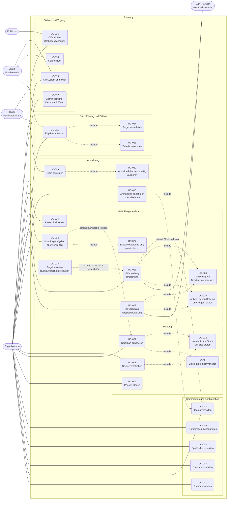

# Use-Case-Diagramm

Dieses Dokument enthält das UML-Use-Case-Diagramm für Tournetty. Quelle sind ausschliesslich
die Dokumente unter `docs/`: [`requirements.md`](../requirements.md) (FR-001–FR-026),
[`vision.md`](../vision.md) (Scope, Target Users) und [`SPEC.md`](../SPEC.md) §4 (Akteure) und
§5 (funktionale Anforderungen).

* **UML-Quelle:** [`use-case-diagram.puml`](use-case-diagram.puml) — normative Notation,
  rendern mit `plantuml docs/use-cases/use-case-diagram.puml`
* **Mermaid-Fassung** unten — rendert direkt in Markdown, bildet UML-Notation nur annähernd ab
  (Mermaid kennt keinen eigenen Use-Case-Diagrammtyp)

## Akteure

| Akteur                | Art         | Rolle                                                              | Quelle              |
|-----------------------|-------------|--------------------------------------------------------------------|---------------------|
| Organisator:in        | primär      | Plant das Turnier, nimmt Anmeldungen an, gibt KI-Vorschläge frei.  | SPEC §4, vision.md  |
| Vorort-Mitarbeitende  | primär      | Erfasst und korrigiert Ergebnisse am Turniertag.                   | SPEC §4, vision.md  |
| Teamverantwortliche:r | primär      | Meldet das Team an und verfolgt den Spielplan.                     | vision.md           |
| Publikum              | primär      | Liest Spielplan und Tabellen.                                      | vision.md           |
| LLM-Provider          | sekundär    | Externes System, liefert Vorschläge. Genau ein Ausgang (ADR-2).    | SPEC §4, ADR-2      |

Teams erhalten keinen Login (C-013); der Teamverantwortliche agiert ausschliesslich über den
öffentlichen, unauthentifizierten Anmelde-Endpunkt und das öffentliche Dashboard.

## Diagramm

## Was im Diagramm bewusst so steht

* **UC-007 hängt nicht am LLM-Provider.** Die Spielplangenerierung ist deterministisch und
  regelbasiert (ADR-3, C-015). Nur UC-012 und UC-013 haben eine Verbindung nach aussen.
* **Genau zwei Use Cases erreichen den Provider** — über denselben Port (ADR-2, NFR-017).
* **UC-014 ist das Gate.** Kein Vorschlag wirkt vor der Annahme durch einen Menschen
  (ADR-5, NFR-013, C-016); deshalb `extend` von UC-014 auf UC-007, nicht `include`.
* **UC-020 ist eigenständig modelliert**, weil die Validierung die Vertrauensgrenze bildet:
  UC-009 ist der einzige unauthentifizierte Schreibfall (NFR-015, NFR-016).
* **UC-019 ist kein `include` jedes Admin-Falls.** Der Zugang wird einmal modelliert
  (FR-026, NFR-010); alle Fälle von Organisator:in und Vorort-Mitarbeitenden setzen ihn voraus.
* **UC-028 als `extend`** deckt den Rückfallpfad bei LLM-Ausfall ab (ADR-003); die Freigabe
  über UC-014 gilt unverändert.

## Traceability zu den Anforderungen

| Use Case | Titel                                         | Anforderungen           |
|----------|-----------------------------------------------|-------------------------|
| UC-001   | Turnier verwalten                             | FR-001, FR-005          |
| UC-002   | Teams verwalten                               | FR-002, FR-005          |
| UC-003   | Gruppen verwalten                             | FR-003, FR-005          |
| UC-004   | Spielfelder verwalten                         | FR-004, FR-005          |
| UC-005   | Turnierregeln konfigurieren                   | FR-024, NFR-004         |
| UC-006   | Phasen planen                                 | FR-009, FR-010          |
| UC-007   | Spielplan generieren                          | FR-011, NFR-005, NFR-008 |
| UC-008   | Spiele verschieben                            | FR-013                  |
| UC-009   | Team anmelden                                 | FR-006, NFR-007         |
| UC-010   | Anmeldung annehmen oder ablehnen              | FR-008                  |
| UC-011   | Ergebnis erfassen                             | FR-014, NFR-007         |
| UC-012   | KI-Vorschlag Gruppenaufteilung anfordern      | FR-019                  |
| UC-013   | KI-Vorschlag Umplanung anfordern              | FR-020, NFR-008         |
| UC-014   | Vorschlag freigeben oder verwerfen            | FR-022, NFR-013         |
| UC-015   | Protokoll einsehen                            | FR-023, NFR-014         |
| UC-016   | Öffentliches Dashboard ansehen                | FR-017, NFR-011         |
| UC-017   | Administrations-Dashboard öffnen              | FR-018                  |
| UC-018   | Spiele filtern                                | FR-025                  |
| UC-019   | Am System anmelden                            | FR-026, NFR-010         |
| UC-020   | Anmeldedaten serverseitig validieren          | FR-007, NFR-015, NFR-016 |
| UC-021   | Spiele auf Felder verteilen                   | FR-012, NFR-003         |
| UC-022   | Invariante «ein Team, ein Slot» prüfen        | NFR-001                 |
| UC-023   | Tabelle berechnen                             | FR-015, NFR-002         |
| UC-024   | Sieger in nächste K.-o.-Runde weiterleiten    | FR-016, NFR-002         |
| UC-025   | Modellantwort gegen Schema und Regeln prüfen  | NFR-018, NFR-006        |
| UC-026   | Vorschlag mit Begründung anzeigen             | FR-021, NFR-012         |
| UC-027   | Entscheid append-only protokollieren          | FR-023, NFR-014         |
| UC-028   | Regelbasierten Rückfallvorschlag erzeugen     | FR-020 (ADR-003)        |

Jede funktionale Anforderung FR-001 bis FR-026 ist genau einem Use Case zugeordnet.
